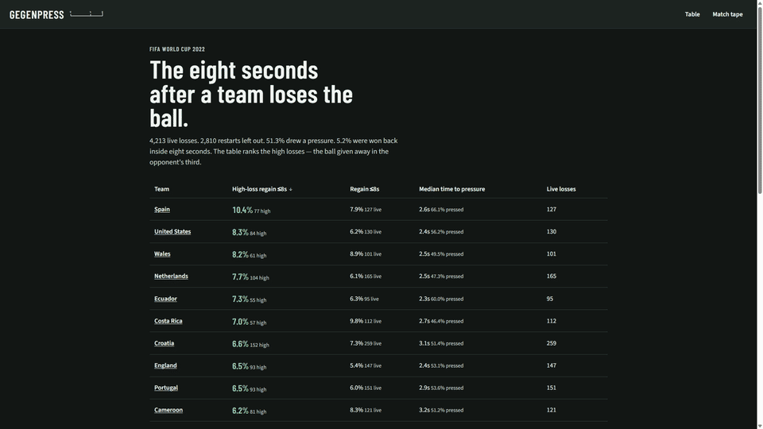
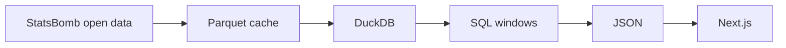

# Football Gegenpress

When a team loses the ball, how often do they win it back within eight seconds, where, and how quickly does pressure arrive?

This is not a pass map. A pass map draws circulation while a team has the ball. This one starts a clock at the moment that possession dies.

World Cup 2022, StatsBomb open data. Built by Noor Sbeih.

[Live site](https://temporary-express-fluorine-c22iqf7.vercel.app) · [source](https://github.com/NoorSbeih/football-gegenpress)



## What the tournament shows

4,213 live losses. 2,810 restarts left out (plus 32 team changes with no locatable touch). Pressure arrived inside eight seconds on **51.3%** of live losses, median 2.7 seconds. The ball came back inside eight seconds on **5.2%**, and inside five seconds on **1.5%**.

StatsBomb's own `counterpress` tag fires on **47.8%** of the same live losses. That is close to the 51.3% pressure rate, which is the check that the clock is not counting a different event.

The number that is not a pass map is the split. Spain win the high-loss regain rate: **10.4%** of 77 losses in the opponent's third. Belgium, Serbia, and Ghana are at **0%** on 61, 58, and 60 high losses. Several of those sides still win the ball back after a loss in their own third, which is defending, not gegenpressing. Low-loss samples are small — the page prints N beside every rate.

The match tape opens on Spain 1–1 Germany. That match is the one with the most live losses involving the team at the top of the high-loss table. It was picked after the counts, not before.

## Definitions

A **loss** is a change of `possession_team` inside one period. The same team keeping the ball across two StatsBomb possession ids is not a loss. Period 5 (the shootout) is dropped before any of this.

The **loss time** is the timestamp of the last on-ball touch by the team that had the ball: pass, carry, shot, dribble, ball receipt, clearance, miscontrol, dispossessed, goalkeeper action, shield, 50/50, block, error, or offside. An incomplete pass uses `pass_end_location`. Anything else uses `location`. The clock is seconds from the start of the period, not the `minute` column.

The **window** runs until eight seconds later, or until the period ends, whichever is first. Five seconds is stored too. The page defaults to eight. If the period ends first, the row is marked censored. The period ending is not counted as a regain.

A **regain** is the first later event, after that spell has ended, whose `possession_team` is the team that lost it, and whose timestamp is still inside the window. If there is none, the time is left empty. It is not filled in as 8.

**Pressure** is a `Pressure` event by the team that lost the ball, after the loss touch and inside the window. `under_pressure` is a different flag and is not used. `counterpress` is only the cross-check above.

**Restarts do not start a clock.** If the other team's first event is a throw-in, goal kick, free kick, corner, kick-off, penalty, or referee ball-drop, the change is excluded.

| Reason | Count |
| --- | --- |
| Throw-in | 956 |
| Goal kick | 950 |
| Free kick | 551 |
| Kick-off | 227 |
| Drop ball | 113 |
| Corner | 13 |
| No on-ball touch to locate | 32 |

**Zones** on the StatsBomb 120×80 pitch, in the attacking direction of the team that lost it: own third `x < 40`, middle `40–80`, opponent third `x ≥ 80`. A high loss is one in the opponent third. A low loss is one in the own third. The high-loss regain rate uses only the high losses as the denominator.

Teams with fewer than 40 live losses are left off the table. Every team at this World Cup clears that bar. The empty state is still there.

Field names were taken from match 3857276 (Canada–Morocco), not guessed. See [docs/event-fields.md](docs/event-fields.md).

## Limitations

Descriptive, not causal. A higher regain rate is not proof that pressing caused the win.

Open data for one tournament is a small sample. Low-loss counts are often under ten, so those percentages move on a handful of events.

The score, the opponent, and game state are not held constant. A team protecting a lead is mixed in with a team chasing one.

Only live losses are counted. Set-piece restarts are out on purpose, so this is not a full picture of defending.

The eight-second cut is a choice. Five seconds, which some counterpress studies use, is much harsher here: 1.5% against 5.2%. Spain's regains in this data sit between five and eight seconds, so the toggle changes their pitch.

## Architecture



`raw` is the parquet loaded into DuckDB. `staging` types the events, builds possession spells, and marks losses. `marts` are the eight-second windows, the team rates, and the pitch bins. The site reads committed JSON. There is no always-on API and no database in production.

## How to run

```powershell
python -m venv .venv
.\.venv\Scripts\Activate.ps1
pip install -e ".[dev]"
gegenpress build --competition wc2022
cd web
npm ci
npm run dev
```

The first build downloads World Cup 2022. A later build prints `cache hit, skipped HTTP` and rebuilds DuckDB and the JSON from `data/raw/`. Parquet and `data/gegenpress.duckdb` are gitignored.

```powershell
ruff check .
ruff format --check .
pytest
cd web
npm run lint
npm run build
```

`npm run lint` calls ESLint. Next.js 16 removed `next lint`. `npm run build` writes a static site to `web/out`.
